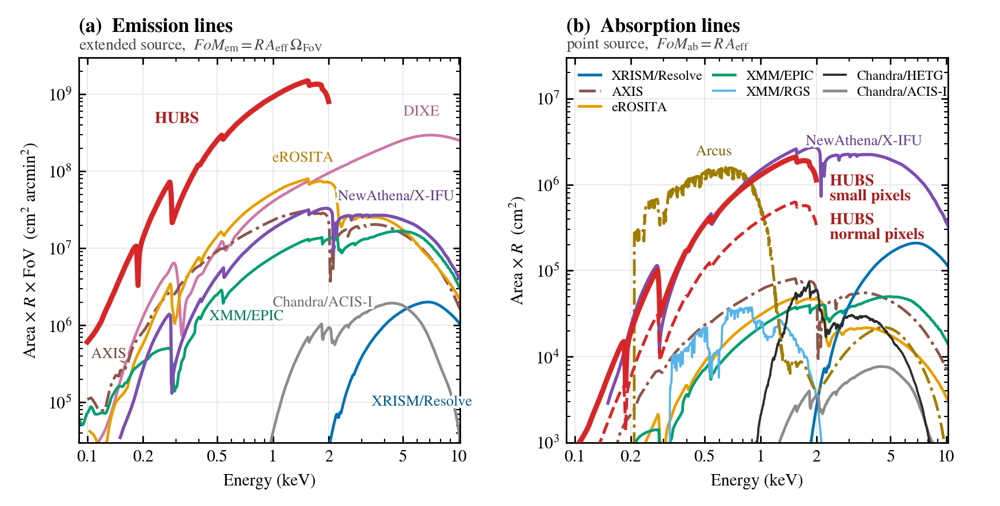

# X 射线望远镜的 figure of merit：一个可执行的教程

*An executable Quarto tutorial (in Chinese) for first-year physics undergraduates: download X-ray mission responses from public servers, derive two figures of merit for detecting weak spectral lines, and reproduce Fig. 3 of the HUBS Galactic Ecosystems white paper.*

哪台 X 射线望远镜最擅长探测一条微弱的谱线？
这个教程从零开始回答这个问题，面向物理系一年级本科生。
它从各任务的官方服务器下载响应文件，推导两种品质因数，最后画出 HUBS 白皮书的 Fig. 3。
这两种品质因数是：

- FoM<sub>em</sub> = R·A·Ω：弥散源的发射线；
- FoM<sub>ab</sub> = R·A：点源的吸收线。



## 文件

| 文件 | 内容 |
|---|---|
| `01_data.qmd` | **教程 1：准备数据。** 用 HTTP Range 请求只读取响应文件里真正用到的字节，结果写进 `data/` |
| `02_fom.qmd` | **教程 2：计算和画图。** 讲解概念、推导公式、列出假设，再逐台仪器计算，最后画出 Fig. 3 |
| [`01_data.md`](01_data.md)、[`02_fom.md`](02_fom.md) | 两份教程的 GitHub 网页版（Actions 在干净环境自动渲染，只含公开数据） |
| [`01_data.ipynb`](01_data.ipynb)、[`02_fom.ipynb`](02_fom.ipynb) | 两份教程的 Jupyter notebook（已运行，输出内嵌，可在线查看或在 Colab/Codespaces 打开） |
| `01_data.html`、`02_fom.html` | 两份教程运行后的完整网页（含全部仪器），可以直接下载打开 |
| `figures/` | 包含全部任务的 Fig. 3 和去掉 AXIS、Arcus 的版本（PDF/PNG），以及所有曲线的 CSV 表 |

> [!NOTE]
> `.md` 和 `.ipynb` 由 [GitHub Actions](.github/workflows/render-tutorial.yml) 在每次修改 `.qmd` 后自动重新渲染。
> 渲染环境没有 HUBS、DIXE、Arcus 的内部响应文件（未公开），所以这两个版本里这三台仪器被自动跳过；
> 其余仪器的响应文件全部从官方服务器实时下载。想看含全部仪器的版本，请下载上面的 HTML 或本地运行 `.qmd`。

## 运行

```bash
pip install numpy astropy matplotlib jupyter     # 另需安装 Quarto：https://quarto.org
quarto render 01_data.qmd                        # 约 2 分钟（需要联网）
quarto render 02_fom.qmd                         # 约 20 秒
```

也可以在 VS Code、Positron 或 RStudio 里打开 `.qmd`，一格一格地运行。

| | 运行前 | 运行后 | 内存峰值 |
|---|---|---|---|
| 教程 1 | 两个 `.qmd` 共约 70 KB | `data/` 约 13 MB（只有公开数据时） | 约 200 MB |
| 教程 2 | — | `figures/` 约 1 MB | 约 150 MB |

原始响应文件合计约 3.8 GB。教程运行时不在硬盘上存任何大文件。

## 数据来源

以下数据都来自公开服务器，由 `01_data.qmd` 自动下载：

- **NewAthena/X-IFU**：2026 年 5 月任务采纳评审的发布版（X-IFU 团队）；渐晕表来自 ESA。
- **XMM-Newton**：EPIC 用 AO-26 提案响应（HEASARC）；RGS 用 SAS v21 的响应（ESA）；渐晕用 CCF。
- **XRISM/Resolve**：Cycle 3 提案响应（HEASARC）。
- **Chandra**：Cycle 28 提案响应（CXC）；HRMA 渐晕来自 CALDB（HEASARC）。
- **eROSITA**：DR1 的响应（MPE）；逐镜渐晕和面积来自 SIXTE（FAU）。
- **AXIS**：2025 年发布的响应（UMD）。

以下三台仪器的响应**没有公开**。需要自己放进 `user_data/`，缺少时教程会跳过这台仪器：

```
user_data/hubs/hubs_cc_v20181130.rmf
user_data/hubs/hubs_cc_v20201227.arf
user_data/hubs/hubs_cc_s_v20201227.arf
user_data/dixe/DIXE_rsp_v1.0.1.arf
user_data/arcus/far_chan_all_-N.rmf                    (N = 2…11)
user_data/arcus/far_chan_all_ccdord_-N_true_-N.arf     (N = 2…11)
user_data/arcus/chan_all_+0.rmf
user_data/arcus/chan_all_+0.arf
```
